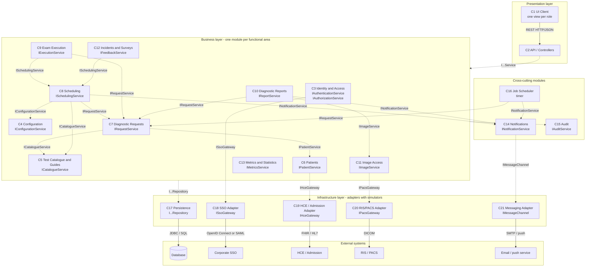

# SESCAM Radiodiagnostics – Initial Architecture Proposal

| | |
|---|---|
| **Author** | Alejandro Aceña |
| **Group** | ISO II – 3A1.04 |
| **Status** | Draft v0.2 – for team discussion |
| **Date** | 27/10/2026 |
| **Input** | `historias_de_usuario_SESCAM_v2.xlsx` (26 user stories, 45 use cases) |

## 1. Purpose

This document covers my assigned task:

- identify the main software components and the responsibility of each one,
- identify the main interfaces and how the components communicate,
- prepare an initial component diagram,
- list the architectural decisions and questions the team needs to discuss,
- estimate the effort with and without AI.

The components come from the user stories (HU) and use cases (CU) in the v2 Excel. Section 9 maps every user story to its components.

**Actors** (from HU-18 and the use cases):

- *People:* patient, physician, admissions staff, system administrator.
- *External systems:* corporate SSO, HCE/admission (FHIR/HL7), RIS/PACS (DICOM), email/push channel.
- *Timer:* a job scheduler that sends reminders and generates follow-up requests.

Nothing here is final. It must be agreed with the team before implementation starts.

## 2. Architectural style

**Proposal: a layered modular monolith.**

- **Layers:** Presentation → Business → Infrastructure.
- **Modules:** the business layer has one module per functional area. The 26 user stories are grouped into 13 modules instead of one module per story (the Excel suggests looking for more cohesive modules).
- **Interfaces:** each module exposes a public interface (`I...Service`). Other modules may only use that interface. They never access another module's classes or database tables directly.
- **External systems:** each one is accessed through an interface (`I...Gateway`) implemented by a replaceable adapter. Each adapter has a **simulator**, as HU-20, HU-21 and HU-24 require.

**Why:**

- It fits a team of 6 and the course timeline.
- It needs a single deployment.
- It is easy to test with mocks and simulators.
- It is easy to map to a Maven project.
- *Microservices* were rejected: too much overhead for the scope.

## 3. Components and responsibilities

| ID | Component | Layer | Responsibility | User stories |
|----|-----------|-------|----------------|--------------|
| C1 | UI Client | Presentation | Screens for each role (patient, physician, admissions, administrator). No business logic. | all |
| C2 | API / Controllers | Presentation | Entry point for the UI. Validates input and checks authentication and permissions on the server for every request. | all |
| C3 | Identity & Access | Business | SSO login, users, roles and permissions; assigns the role from the corporate identity. | HU-18, HU-20 |
| C4 | Configuration | Business | System parameters: room schedules, appointment policies, priority levels, reminder lead time. Changes apply only to future appointments. | HU-17 |
| C5 | Test Catalogue & Guides | Business | Test types with all their attributes (modality, room/equipment, duration, preparation, contrast/consent, restrictions, follow-up suitability) and the clinical guides of each test. Logical deactivation. | HU-23, HU-05 |
| C6 | Patients | Business | Register, update and deactivate patients (logical deactivation, no duplicates). Gets patient data from HCE/admission. | HU-12, HU-21 |
| C7 | Diagnostic Requests | Business | Physician prescribes tests (indication, justification, priority); follow-up series with recurrence; request status and filters; follow-up calendar for the patient. **Owns the request status.** | HU-06, HU-07, HU-08, HU-05 |
| C8 | Scheduling | Business | Agenda and free slots, assigning appointments without overlaps, confirm/cancel/reschedule, patient change requests, daily worklists, waiting list by priority, proposing freed slots. | HU-01, HU-13, HU-26, HU-14, HU-15, HU-08 |
| C9 | Exam Execution | Business | Records how the exam was performed (actual time, room/equipment, notes) and its incidents. Marks the request as performed. | HU-10 |
| C10 | Diagnostic Reports | Business | Drafting, editing, reviewing and signing reports with versioning (a signed report is never overwritten). Patient's test history. | HU-09, HU-03 |
| C11 | Image Access | Business | Opens the DICOM web viewer from the report, applies the image access policy, shows a clear message if the PACS is down. | HU-25, HU-24 |
| C12 | Incidents & Surveys | Business | Patient incidents (optionally linked to an appointment) and a satisfaction survey (only once per completed test). | HU-04 |
| C13 | Metrics & Statistics | Business | **One shared metrics engine** for physician metrics, operational reports and global statistics. Filters by period and export. | HU-11, HU-16, HU-22 |
| C14 | Notifications | Cross-cutting | Reminders, preparation instructions, report-available notices, patient inbox. The sending channel (email/push) is decoupled. | HU-02 (used by HU-01, 09, 13, 26) |
| C15 | Audit | Cross-cutting | Records user, date, action and resource for every access to clinical data, and lets the administrator query it. Records cannot be edited or deleted. | HU-19 (used by HU-03, 09, 25, 15, 17, 18) |
| C16 | Job Scheduler | Cross-cutting | The "timer" actor: sends due reminders and generates follow-up requests. | HU-02, HU-07 |
| C17 | Persistence | Infrastructure | Repository implementations (JPA/JDBC) for each module. | all |
| C18 | SSO Adapter | Infrastructure | Implements `ISsoGateway`, plus an SSO simulator for testing. | HU-20 |
| C19 | HCE / Admission Adapter | Infrastructure | Implements `IHceGateway` (FHIR/HL7), plus a simulator. | HU-21 |
| C20 | RIS/PACS Adapter | Infrastructure | Implements `IPacsGateway` (DICOM query and retrieve), plus a simulator. Images are not copied. | HU-24 |
| C21 | Messaging Adapter | Infrastructure | Implements `IMessageChannel` (email/push; a stub at first). | HU-02 |

## 4. Interfaces

### 4.1 Interfaces provided by the modules

| Interface | Provided by | Used by | Main operations (draft) |
|-----------|-------------|---------|-------------------------|
| `IAuthenticationService` | C3 | C2 | `loginWithSso()`, `currentUser()`, `logout()` |
| `IAuthorizationService` | C3 | C2, all modules | `hasPermission(user, action, resource)`, `assignRole(...)`, `removeRole(...)` |
| `IConfigurationService` | C4 | C8, C14 | `getRoomSchedule(room)`, `getAppointmentPolicy()`, `getPriorityLevels()`, `getReminderLeadTime()`, `update(parameter, value)` |
| `ICatalogueService` | C5 | C7, C8, C14 | `findTestType(id)`, `listActiveTestTypes()`, `isRequestable(id)`, `getGuides(testType)`, `create/update/deactivate(...)` |
| `IPatientService` | C6 | C2, C7, C8 | `register(data)`, `update(id, data)`, `deactivate(id)`, `findById(id)`, `search(criteria)` |
| `IRequestService` | C7 | C2, C8, C9, C10, C16 | `create(request)`, `createFollowUpSeries(...)`, `suspendSeries(id)`, `find(filters)`, `getPendingForScheduling()`, `changePriority(id, priority, justification)`, `markScheduled(id)`, `markPerformed(id)`, `markReported(id)`, `cancel(id)`, `generateDueFollowUps()`, `getFollowUpCalendar(patient)` |
| `ISchedulingService` | C8 | C2, C9, C12 | `findFreeSlots(testType, period)`, `book(requestId, slot)`, `confirm(id)`, `cancel(id)`, `reschedule(id, slot)`, `requestChange(id, ...)`, `resolveChange(id, accepted)`, `getPatientAppointments(patient)`, `getDailyWorklist(date, room/professional)`, `reassign(...)`, `getWaitingList()` |
| `IExecutionService` | C9 | C2, C10 | `registerExecution(appointmentId, data)`, `registerIncident(executionId, incident)`, `getExecution(requestId)` |
| `IReportService` | C10 | C2 | `saveDraft(...)`, `sign(reportId)`, `getReport(id)`, `getVersions(id)`, `getPatientHistory(patient)` |
| `IImageService` | C11 | C10 | `openViewer(requestId)` → viewer URL, or a "PACS unavailable" result |
| `IFeedbackService` | C12 | C2 | `submitIncident(...)`, `getMyIncidents(patient)`, `submitSurvey(requestId, answers)` |
| `IMetricsService` | C13 | C2 | `physicianMetrics(physician, period)`, `operationalReport(filters)`, `globalStatistics(filters)`, `export(report, format)` |
| `INotificationService` | C14 | C8, C10, C16 | `notify(patient, type, data)`, `scheduleReminder(appointment)`, `cancelReminder(appointment)`, `sendDueReminders()`, `getInbox(patient)` |
| `IAuditService` | C15 | all modules that access clinical data | `record(user, action, resource)`, `query(filters)` (there is no update or delete) |

### 4.2 Interfaces required by the business layer (implemented by infrastructure)

| Interface | Implemented by | Used by |
|-----------|----------------|---------|
| `I...Repository` (one per entity: patient, request, appointment, execution, report, test type, user, audit record…) | C17 | each module, only its own repositories. C13 uses read-only query repositories. |
| `ISsoGateway` | C18 + simulator | C3 |
| `IHceGateway` | C19 + simulator | C6 |
| `IPacsGateway` | C20 + simulator | C11 |
| `IMessageChannel` | C21 | C14 |

## 5. Communication between components

| From → To | Mechanism |
|-----------|-----------|
| UI Client → API | HTTP/JSON (REST). |
| API → modules | Direct Java calls through the `I...Service` interfaces (dependency injection). |
| Module → module | Direct calls through the other module's interface. This matches the «include» relations of the use cases (for example, assigning an appointment includes sending a notification). |
| Job Scheduler → modules | Periodic calls: `INotificationService.sendDueReminders()` and `IRequestService.generateDueFollowUps()`. |
| Module → database | Through its own repositories (JPA/JDBC, SQL). |
| Adapters → external systems | SSO: OpenID Connect or SAML (to decide). HCE/admission: FHIR / HL7. PACS: DICOM. Notifications: SMTP / push. |

**Rules:**

- Presentation → Business → interfaces ← Infrastructure.
- There are no cycles between modules. For example, C8 calls C7, but C7 never calls C8.
- Only C7 changes the request status. The other modules call it: C8 `markScheduled`, C9 `markPerformed`, C10 `markReported`.
- Permissions are checked on the server, not only in the UI (HU-18).
- Every access to clinical data calls `IAuditService` (CU-38).
- Integration failures are recorded and **never block the rest of the system** (CU-42). For example, if the PACS is down, the physician can still write the report (HU-25).

**Request status (C7, from HU-06 and HU-08):**

```
pending appointment → scheduled → performed → reported
any status before performed → cancelled
```

### Main flow (end to end)

1. A user logs in with the SSO: UI → API → `IAuthenticationService` (C3) → `ISsoGateway`. The role is taken from HU-18.
2. Admissions registers a patient: `IPatientService` (C6) gets the data with `IHceGateway`. If the HCE fails, the failure is recorded and the data is entered manually.
3. A physician prescribes a test: `IRequestService.create` (C7), which checks the patient (`IPatientService`) and the test rules (`ICatalogueService`). The request status becomes *pending appointment*.
4. Admissions assigns an appointment:
   - `ISchedulingService.book` (C8) only accepts a compatible slot without overlaps (`ICatalogueService`, `IConfigurationService`).
   - Then it calls `IRequestService.markScheduled`.
   - Finally it calls `INotificationService` (notification and reminder).
5. The patient confirms, cancels or asks to change the appointment (C8). A cancellation frees the slot, and the waiting list proposes the most urgent compatible request (HU-15).
6. The Job Scheduler (C16) sends the reminders that are due and generates the follow-up requests.
7. The physician records the exam execution: `IExecutionService` (C9) → `IRequestService.markPerformed`.
8. The physician writes and signs the report:
   - `IReportService` (C10) opens the images with `IImageService` (C11 → `IPacsGateway`).
   - The physician signs; the report becomes a new version that is never overwritten.
   - Then it calls `IRequestService.markReported` and `INotificationService` (report available).
9. The patient checks their history and the report: `IReportService.getPatientHistory`, and every access is recorded with `IAuditService`.

## 6. Initial component diagram



*Dashed arrow = uses the interface named on the arrow. Solid arrow = communication protocol. To keep the diagram readable, some secondary dependencies appear only in table 4.1 (for example, C14 also uses C4 and C5, C8 also uses C6, and C10 also uses C9).*

### Suggested mapping to the Maven project (to align with Pablo's structure proposal)

The project is packaged by module:

```
src/main/java/.../radiodiagnostics/
├── auth/  configuration/  catalogue/  patient/  request/  scheduling/
├── execution/  report/  image/  feedback/  metrics/
├── notification/  audit/  jobs/
├── web/       C2 controllers
└── shared/    common types and exceptions
```

Inside each module there are sub-packages:

- `api` – the public interface and its DTOs,
- `domain` – entities and rules,
- `application` – the service implementation,
- `infrastructure` – repositories, adapters and simulators.

The project starts as a single Maven module and can be split later if needed.

## 7. Proposed architectural decisions

| ID | Decision | Rationale |
|----|----------|-----------|
| AD-01 | Layered modular monolith | Team size, timeline, simple deployment |
| AD-02 | 13 modules by functional area (not one per user story); they communicate only through interfaces | Cohesion and low coupling; each member can own modules |
| AD-03 | Each external system behind a replaceable adapter with a simulator | Required by HU-20, HU-21 and HU-24; testable without the real systems |
| AD-04 | Integration failures are recorded and never block the rest of the system | CU-42, HU-21, HU-24, HU-25 |
| AD-05 | Only C7 changes the request status | A single source of truth for the request lifecycle (HU-08) |
| AD-06 | A single notification service with a decoupled channel | HU-02; reused by HU-01, 09, 13 and 26 |
| AD-07 | Cross-cutting, append-only audit | HU-19, CU-38 (GDPR: health data) |
| AD-08 | One metrics engine for HU-11, HU-16 and HU-22 | Suggested in the Excel; avoids repeating the same queries three times |
| AD-09 | Permissions checked on the server and in the UI | HU-18 |
| AD-10 | Images are not stored, only retrieved from the PACS | HU-24 ("without duplicating them") |

## 8. Questions to discuss with the team

| # | Question | My recommendation |
|---|----------|-------------------|
| Q1 | Which is the source of truth for patient data: our system (HU-12) or HCE/admission (HU-21)? (pending in the Excel, goes to `DECISIONS.md`) | HCE/admission when the patient exists there. Our system keeps a local copy and the data HCE does not have. |
| Q2 | Which SSO protocol (HU-20)? (goes to `DECISIONS.md`) | OpenID Connect: simpler, and easy to simulate |
| Q3 | Where is the boundary between HU-17 (configuration), HU-23 (catalogue) and HU-15 (priorities)? | Catalogue = attributes of each test type. Configuration = global parameters (schedules, policies, priority levels). The waiting list only uses the priority levels from Configuration. |
| Q4 | Web app or desktop app? | Web: HU-25 asks for a *web* DICOM viewer and HU-02 for push notifications |
| Q5 | Spring Boot or plain Java? This affects Pablo's Maven structure. | Spring Boot (dependency injection, JPA, security, scheduled jobs) |
| Q6 | Which database? | H2 for development and tests, PostgreSQL or MySQL for the demo |
| Q7 | Direct calls between modules, or events? | Direct calls for now (simpler, and they match the «include» relations of the use cases). Events only if cycles appear. |
| Q8 | Single Maven module or multi-module? | Single module with one package per component; split later if needed |
| Q9 | Are there only 4 roles (patient, physician, admissions, administrator)? In the user stories, the physician also records the exam execution (HU-10). | Keep the 4 roles of HU-18 |
| Q10 | Notification channels: email, push, or only the in-app inbox? | In-app inbox and an email stub first; push later |

## 9. Traceability: user stories → components

| HU | Name | Components | Block |
|----|------|------------|:-----:|
| HU-01 | Manage my appointments | C8, C14 | 2 |
| HU-02 | Notifications and reminders | C14, C16, C21 | 2 |
| HU-03 | My test history | C10, C15 | 3 |
| HU-04 | Incidents and satisfaction surveys | C12 | 4 |
| HU-05 | Clinical guides and follow-up calendar | C5, C7 | 4 |
| HU-06 | Prescribe a diagnostic test | C7, C5, C6 | 2 |
| HU-07 | Periodic follow-up tests | C7, C16 | 3 |
| HU-08 | Request status and agendas | C7, C8 | 3 |
| HU-09 | Write, review and sign reports | C10, C14, C15 | 3 |
| HU-10 | Record exam execution and incidents | C9, C7 | 3 |
| HU-11 | Physician operational metrics | C13 | 4 |
| HU-12 | Patient demographic data | C6, C19 | 2 |
| HU-13 | Assign appointments | C8, C14 | 2 |
| HU-14 | Daily worklists | C8 | 3 |
| HU-15 | Waiting lists and priorities | C8, C7, C4 | 3 |
| HU-16 | Operational reports | C13 | 4 |
| HU-17 | System parameters | C4, C15 | 1 |
| HU-18 | Roles and permissions | C3, C2 | 1 |
| HU-19 | Audit of access to clinical data | C15 | 1 |
| HU-20 | Corporate SSO | C3, C18 | 1 |
| HU-21 | HCE and admission integration (FHIR/HL7) | C19, C6 | 2 |
| HU-22 | Global statistics | C13 | 4 |
| HU-23 | Test type catalogue | C5 | 1 |
| HU-24 | RIS/PACS integration (DICOM) | C20, C11 | 3 |
| HU-25 | DICOM images from the report | C11, C10 | 3 |
| HU-26 | Reschedule/cancel appointments and change requests | C8, C14 | 2 |

The "Block" column is the build order suggested in the Excel:

1. Cross-cutting base: C3, C4, C5, C15 (+ C18).
2. Scheduling core: C6, C7, C8, C14, C16 (+ C19, C21).
3. Execution and reports: C9, C10, C11 (+ C20), plus the worklists and waiting list of C8.
4. Exploitation and add-ons: C12, C13.

The architecture lets us build in this order, because each block only depends on components of the same block or of earlier ones.

## 10. Effort estimation (this task)

The "with AI" column uses the team's factor from the Excel (0.5 of the time without AI).

| Activity | Without AI (h) | With AI (h) |
|----------|---------------:|------------:|
| Analysis of the user stories and use cases | 3 | 1.5 |
| Identify components and responsibilities | 3 | 1.5 |
| Interfaces and communication between components | 3 | 1.5 |
| Component diagram | 2.5 | 1.25 |
| Writing the document, traceability and questions | 2 | 1 |
| Team review and adjustments | 1.5 | 0.75 |
| **Total** | **15** | **7.5** |

**Estimated saving:** 7.5 h.

**Next step (once the architecture is agreed):** create the package skeleton, the module interfaces and the simulators. This is about 8–10 h without AI and 4–5 h with AI. Everything generated with AI has to be reviewed.
