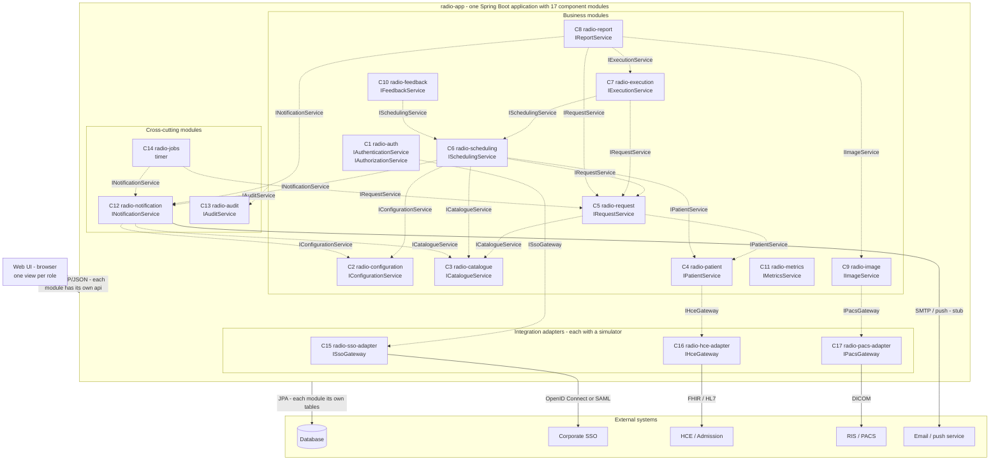

# SESCAM Radiodiagnostics – Architecture Proposal

| | |
|---|---|
| **Author** | Alejandro Aceña |
| **Group** | ISO II – 3A1.04 |
| **Status** | Draft v0.3 – reviewed with Pablo, to be confirmed at the team meeting |
| **Date** | 04/11/2026 |
| **Inputs** | `historias_de_usuario_SESCAM_v2.xlsx` (26 user stories, 45 use cases), Pablo's feedback on the Maven structure (02/11/2026) |

## 1. Purpose

This version covers my second task:

- review the architecture draft,
- confirm the main components and their responsibilities,
- identify the main interfaces and dependencies,
- check that the architecture covers the user stories and use cases,
- align the components with Pablo's Maven structure,
- record the key decisions in `DECISIONS.md`.

### Changes since v0.2

- **One Maven submodule per component**, as the assignment requires. There are **17 component modules** plus `radio-app`, which only starts the application and has no business logic. The components have been renumbered C1–C17 to match the modules.
- **No central API module.** Each module has its own `api`: its public interfaces, its DTOs and its REST controllers. Every interface lives in the module of the component that provides it. The old C2 "API / Controllers" component disappears.
- **No central persistence module.** Each module has its own repositories and tables. The old C17 "Persistence" component disappears.
- The **messaging adapter** (email/push) is now inside `radio-notification`, because only that module uses it and it has no user story of its own.
- **Technology:** Java 17, Spring Boot 3.5.16, JUnit 5 (Pablo's proposal).
- Permissions are checked with **Spring Security**, configured in `radio-auth`. The other modules do not need a Maven dependency on `radio-auth`, which avoids dependency cycles.
- New: a table of dependencies between modules (section 5) and the coverage of the 45 use cases (section 9).

## 2. Architectural style and technology

- **Style:** a modular monolith. There are 17 component modules, deployed together as **one Spring Boot application** (`radio-app`).
- **Inside each module:** the layers are `api` (public interfaces, DTOs, REST controllers), `domain`, `application` and `infrastructure`.
- **Module communication:** modules communicate only through the other module's `api` interfaces. A module never uses another module's classes or tables directly.
- **External systems:** each one (SSO, HCE/admission, PACS) has its own adapter module with a **simulator**, as HU-20, HU-21 and HU-24 require.
- **Stack:** Java 17 · Maven (multi-module) · Spring Boot 3.5.16 · JUnit 5.

## 3. Components (= Maven modules)

| ID | Maven module | Component | Responsibility | Provides | REST api | User stories |
|----|--------------|-----------|----------------|----------|----------|--------------|
| C1 | `radio-auth` | Identity & Access | SSO login, users, roles and permissions (matrix of 4 roles). Configures Spring Security for the whole application. | `IAuthenticationService`, `IAuthorizationService` | `/api/auth` | HU-18, HU-20 |
| C2 | `radio-configuration` | Configuration | Room schedules, appointment policies, priority levels, reminder lead time. Changes apply only to future appointments. | `IConfigurationService` | `/api/config` | HU-17 |
| C3 | `radio-catalogue` | Test Catalogue & Guides | Test types and their attributes (modality, room/equipment, duration, preparation, contrast/consent, restrictions, follow-up suitability). Clinical guides. Logical deactivation. | `ICatalogueService` | `/api/catalogue` | HU-23, HU-05 |
| C4 | `radio-patient` | Patients | Register, update and deactivate patients (logical deactivation, no duplicates). Gets data from HCE/admission. | `IPatientService` | `/api/patients` | HU-12, HU-21 |
| C5 | `radio-request` | Diagnostic Requests | Prescribing tests, follow-up series, priority changes, filters, follow-up calendar. **Owns the request status.** | `IRequestService` | `/api/requests` | HU-06, HU-07, HU-08, HU-05, HU-15 |
| C6 | `radio-scheduling` | Scheduling | Agenda and free slots, booking without overlaps, confirm/cancel/reschedule, change requests, daily worklists, waiting list, proposing freed slots. | `ISchedulingService` | `/api/appointments` | HU-01, HU-13, HU-26, HU-14, HU-15, HU-08 |
| C7 | `radio-execution` | Exam Execution | Records how the exam was performed (actual time, room/equipment, notes) and its incidents. | `IExecutionService` | `/api/executions` | HU-10 |
| C8 | `radio-report` | Diagnostic Reports | Draft, edit, review and sign reports. Signed reports are versioned and never overwritten. Patient's test history. | `IReportService` | `/api/reports` | HU-09, HU-03 |
| C9 | `radio-image` | Image Access | Opens the DICOM web viewer from the report, applies the image access policy, shows a clear message if the PACS is down. | `IImageService` | `/api/images` | HU-25, HU-24 |
| C10 | `radio-feedback` | Incidents & Surveys | Patient incidents, and a satisfaction survey only once per completed test. | `IFeedbackService` | `/api/feedback` | HU-04 |
| C11 | `radio-metrics` | Metrics & Statistics | One metrics engine for physician metrics, operational reports and global statistics. Filters by period and export. | `IMetricsService` | `/api/metrics` | HU-11, HU-16, HU-22 |
| C12 | `radio-notification` | Notifications | Notifications, reminders, preparation instructions, patient inbox. Contains the email/push channel (a stub at first). | `INotificationService` | `/api/notifications` | HU-02 |
| C13 | `radio-audit` | Audit | Records user, date, action and resource for every access to clinical data, and lets the administrator query it. Records cannot be edited or deleted. | `IAuditService` | `/api/audit` | HU-19 |
| C14 | `radio-jobs` | Job Scheduler | The "timer" actor: sends due reminders and generates follow-up requests. | – | – | HU-02, HU-07 |
| C15 | `radio-sso-adapter` | SSO Adapter | Connection to the corporate SSO, plus a simulator. | `ISsoGateway` | – | HU-20 |
| C16 | `radio-hce-adapter` | HCE / Admission Adapter | FHIR/HL7 connection to HCE and admission, plus a simulator. | `IHceGateway` | – | HU-21 |
| C17 | `radio-pacs-adapter` | RIS/PACS Adapter | DICOM query and retrieve, plus a simulator. Images are never copied. | `IPacsGateway` | – | HU-24 |
| – | `radio-app` | *(not a component)* | `@SpringBootApplication`, configuration (`application.yml`, profiles to choose real adapters or simulators), static web pages of the UI. Depends on all 17 modules and builds the executable jar. | – | – | – |

## 4. Interfaces

Each interface lives in the `api` package of the module that provides it.

| Interface | Module | Used by | Main operations (draft) |
|-----------|--------|---------|-------------------------|
| `IAuthenticationService` | C1 auth | UI (REST) | `loginWithSso()`, `currentUser()`, `logout()` |
| `IAuthorizationService` | C1 auth | UI (REST) | `assignRole(user, role)`, `removeRole(user, role)`, `getPermissions(user)` (checks are done by Spring Security) |
| `IConfigurationService` | C2 configuration | C6, C12 | `getRoomSchedule(room)`, `getAppointmentPolicy()`, `getPriorityLevels()`, `getReminderLeadTime()`, `update(parameter, value)` |
| `ICatalogueService` | C3 catalogue | C5, C6, C12 | `findTestType(id)`, `listActiveTestTypes()`, `isRequestable(id)`, `getGuides(testType)`, `create/update/deactivate(...)` |
| `IPatientService` | C4 patient | C5, C6 | `register(data)`, `update(id, data)`, `deactivate(id)`, `findById(id)`, `search(criteria)` |
| `IRequestService` | C5 request | C6, C7, C8, C14 | `create(...)`, `createFollowUpSeries(...)`, `suspendSeries(id)`, `find(filters)`, `getPendingForScheduling()`, `changePriority(id, priority, justification)`, `markScheduled(id)`, `markUnscheduled(id)`, `markPerformed(id)`, `markReported(id)`, `cancel(id)`, `generateDueFollowUps()`, `getFollowUpCalendar(patient)` |
| `ISchedulingService` | C6 scheduling | C7, C10 | `findFreeSlots(testType, period)`, `book(requestId, slot)`, `confirm(id)`, `cancel(id)`, `reschedule(id, slot)`, `requestChange(...)`, `resolveChange(id, accepted)`, `getPatientAppointments(patient)`, `getDailyWorklist(date, room/professional)`, `reassign(...)`, `getWaitingList()` |
| `IExecutionService` | C7 execution | C8 | `registerExecution(appointmentId, data)`, `registerIncident(executionId, incident)`, `getExecution(requestId)` |
| `IReportService` | C8 report | UI (REST) | `saveDraft(...)`, `sign(reportId)`, `getReport(id)`, `getVersions(id)`, `getPatientHistory(patient)` |
| `IImageService` | C9 image | C8 | `openViewer(requestId)` → viewer URL, or a "PACS unavailable" result |
| `IFeedbackService` | C10 feedback | UI (REST) | `submitIncident(...)`, `getMyIncidents(patient)`, `submitSurvey(requestId, answers)` |
| `IMetricsService` | C11 metrics | UI (REST) | `physicianMetrics(physician, period)`, `operationalReport(filters)`, `globalStatistics(filters)`, `export(report, format)` |
| `INotificationService` | C12 notification | C6, C8, C14 | `notify(patient, type, data)`, `scheduleReminder(appointment)`, `cancelReminder(appointment)`, `sendDueReminders()`, `getInbox(patient)` |
| `IAuditService` | C13 audit | C1, C2, C4, C5, C8, C9 | `record(user, action, resource)`, `query(filters)` (there is no update or delete) |
| `ISsoGateway` | C15 sso-adapter | C1 | `authenticate(token)`, `getCorporateIdentity(token)` |
| `IHceGateway` | C16 hce-adapter | C4 | `findPatient(identifier)` |
| `IPacsGateway` | C17 pacs-adapter | C9 | `findStudies(requestId)`, `getViewerUrl(studyUid)` |

## 5. Dependencies between modules

This table is the list of `<dependency>` entries between our modules in each `pom.xml`. A module depends on another one because it uses that module's interface.

| Module | Depends on | Interfaces used |
|--------|------------|-----------------|
| C1 `radio-auth` | sso-adapter, audit | `ISsoGateway`, `IAuditService` |
| C2 `radio-configuration` | audit | `IAuditService` |
| C3 `radio-catalogue` | – | – |
| C4 `radio-patient` | hce-adapter, audit | `IHceGateway`, `IAuditService` |
| C5 `radio-request` | patient, catalogue, audit | `IPatientService`, `ICatalogueService`, `IAuditService` |
| C6 `radio-scheduling` | request, patient, catalogue, configuration, notification | `IRequestService`, `IPatientService`, `ICatalogueService`, `IConfigurationService`, `INotificationService` |
| C7 `radio-execution` | scheduling, request | `ISchedulingService`, `IRequestService` |
| C8 `radio-report` | request, execution, image, notification, audit | `IRequestService`, `IExecutionService`, `IImageService`, `INotificationService`, `IAuditService` |
| C9 `radio-image` | pacs-adapter, audit | `IPacsGateway`, `IAuditService` |
| C10 `radio-feedback` | scheduling | `ISchedulingService` |
| C11 `radio-metrics` | – | read-only queries (decision D-06) |
| C12 `radio-notification` | configuration, catalogue | `IConfigurationService`, `ICatalogueService` |
| C13 `radio-audit` | – | – |
| C14 `radio-jobs` | notification, request | `INotificationService`, `IRequestService` |
| C15–C17 adapters | – | – |
| `radio-app` | all 17 modules | – |

**There are no cycles.** Ordering the modules by levels shows it: each module only depends on modules of lower levels. This is also a valid build order.

| Level | Modules |
|:-----:|---------|
| 0 | audit, catalogue, metrics, sso-adapter, hce-adapter, pacs-adapter |
| 1 | auth, configuration, patient, image |
| 2 | request, notification |
| 3 | scheduling, jobs |
| 4 | execution, feedback |
| 5 | report |
| 6 | radio-app |

**Rules:**

- A module only uses the `api` package of another module.
- No module depends on `radio-app`.
- The adapters do not depend on any of our modules.
- Only C5 changes the request status. C6 calls `markScheduled` and `markUnscheduled`, C7 `markPerformed`, and C8 `markReported`.
- Permissions are checked on the server with Spring Security (HU-18). This is configured in C1, and the other modules use the roles and the current user from Spring Security.
- Every access to clinical data calls `IAuditService` (CU-38).
- Integration failures are recorded and never block the rest of the system (CU-42). For example, if the PACS is down, the physician can still write the report (HU-25).

## 6. Communication between components

| From → To | Mechanism |
|-----------|-----------|
| UI → modules | HTTP/JSON. Each module exposes its own REST api (`/api/...`). |
| Module → module | Direct Java calls through the other module's `api` interfaces (Spring dependency injection). This matches the «include» relations of the use cases. |
| Job Scheduler → modules | Periodic calls: `sendDueReminders()` and `generateDueFollowUps()`. |
| Module → database | JPA, each module with its own tables. |
| Adapters → external systems | SSO: OpenID Connect or SAML (pending decision). HCE/admission: FHIR/HL7. PACS: DICOM. Notifications: SMTP/push (stub). |

### Main flow (end to end)

1. A user logs in with the SSO: C1 → `ISsoGateway`. The role comes from the role matrix of HU-18.
2. Admissions registers a patient: C4 gets the data with `IHceGateway`. If the HCE fails, the failure is recorded and the data is entered manually.
3. A physician prescribes a test: C5 checks the patient (`IPatientService`) and the test rules (`ICatalogueService`). The request status becomes *pending appointment*.
4. Admissions books an appointment:
   - C6 only accepts a compatible slot without overlaps.
   - Then it calls `IRequestService.markScheduled`.
   - Finally it calls `INotificationService` (notification and reminder).
5. The patient confirms, cancels or asks to change the appointment (C6). A cancellation frees the slot, and the waiting list proposes the most urgent compatible request (HU-15).
6. The Job Scheduler (C14) sends the reminders that are due and generates the follow-up requests.
7. The physician records the exam execution: C7 → `IRequestService.markPerformed`.
8. The physician writes and signs the report:
   - C8 opens the images with `IImageService` (C9 → `IPacsGateway`).
   - The physician signs; the report becomes a new version that is never overwritten.
   - Then C8 calls `IRequestService.markReported` and `INotificationService` (report available).
9. The patient checks their history and the report (C8), and every access is recorded with `IAuditService`.

## 7. Component diagram



*Dashed arrow = Maven dependency: the module uses the interface named on the arrow. Solid arrow = communication protocol. `IAuditService` is used by C1, C2, C4, C5, C8 and C9; the diagram shows it as a single arrow.*

## 8. Maven project structure

The structure has to match Pablo's `pom.xml`.

```
radio (parent pom)
├── radio-auth            ├── radio-feedback
├── radio-configuration   ├── radio-metrics
├── radio-catalogue       ├── radio-notification
├── radio-patient         ├── radio-audit
├── radio-request         ├── radio-jobs
├── radio-scheduling      ├── radio-sso-adapter
├── radio-execution       ├── radio-hce-adapter
├── radio-report          ├── radio-pacs-adapter
├── radio-image           └── radio-app   (Spring Boot application, not a component)
```

Each module has the same packages inside:

```
<base-package>.<module>.api             public interfaces, DTOs, REST controllers
<base-package>.<module>.domain          entities and business rules
<base-package>.<module>.application     implementation of the interfaces
<base-package>.<module>.infrastructure  repositories (and, in the adapters, the real client and the simulator)
```

## 9. Coverage of the user stories and use cases

### 9.1 User stories → components

| HU | Name | Components | Block |
|----|------|------------|:-----:|
| HU-01 | Manage my appointments | C6, C12 | 2 |
| HU-02 | Notifications and reminders | C12, C14 | 2 |
| HU-03 | My test history | C8, C13 | 3 |
| HU-04 | Incidents and satisfaction surveys | C10 | 4 |
| HU-05 | Clinical guides and follow-up calendar | C3, C5 | 4 |
| HU-06 | Prescribe a diagnostic test | C5, C3, C4 | 2 |
| HU-07 | Periodic follow-up tests | C5, C14 | 3 |
| HU-08 | Request status and agendas | C5, C6 | 3 |
| HU-09 | Write, review and sign reports | C8, C12, C13 | 3 |
| HU-10 | Record exam execution and incidents | C7, C5 | 3 |
| HU-11 | Physician operational metrics | C11 | 4 |
| HU-12 | Patient demographic data | C4, C16 | 2 |
| HU-13 | Assign appointments | C6, C12 | 2 |
| HU-14 | Daily worklists | C6 | 3 |
| HU-15 | Waiting lists and priorities | C6, C5, C2 | 3 |
| HU-16 | Operational reports | C11 | 4 |
| HU-17 | System parameters | C2, C13 | 1 |
| HU-18 | Roles and permissions | C1 | 1 |
| HU-19 | Audit of access to clinical data | C13 | 1 |
| HU-20 | Corporate SSO | C1, C15 | 1 |
| HU-21 | HCE and admission integration (FHIR/HL7) | C16, C4 | 2 |
| HU-22 | Global statistics | C11 | 4 |
| HU-23 | Test type catalogue | C3 | 1 |
| HU-24 | RIS/PACS integration (DICOM) | C17, C9 | 3 |
| HU-25 | DICOM images from the report | C9, C8 | 3 |
| HU-26 | Reschedule/cancel appointments and change requests | C6, C12 | 2 |

### 9.2 Use cases → components

| Component | Use cases |
|-----------|-----------|
| C1 auth | CU-37, CU-40 |
| C2 configuration | CU-36 |
| C3 catalogue | CU-11, CU-45 |
| C4 patient | CU-25, CU-26, CU-27 |
| C5 request | CU-12, CU-13, CU-14, CU-15, CU-16, CU-17, CU-33 |
| C6 scheduling | CU-01, CU-02, CU-03, CU-04, CU-18, CU-28, CU-29, CU-30, CU-31, CU-32, CU-34 |
| C7 execution | CU-22, CU-23 |
| C8 report | CU-07, CU-08, CU-19, CU-20 |
| C9 image | CU-21 |
| C10 feedback | CU-09, CU-10 |
| C11 metrics | CU-24, CU-35, CU-44 |
| C12 notification | CU-05, CU-06 |
| C13 audit | CU-38, CU-39 |
| C14 jobs | triggers CU-05 (reminders) and CU-16 (future requests) |
| C15 sso-adapter | CU-40 (secondary actor), CU-42 |
| C16 hce-adapter | CU-41, CU-42 |
| C17 pacs-adapter | CU-43, CU-42 |

**Result:**

- All 26 user stories and all 45 use cases are covered.
- Every component covers at least one use case, so none is unnecessary.
- The block order of the Excel works with the dependency levels of section 5:
  - block 1 only needs levels 0–1;
  - block 2 needs patient, request, scheduling, notification and jobs;
  - block 3 needs execution, report and image;
  - block 4 needs feedback and metrics.

**Note for the team:** C6 `radio-scheduling` is the biggest module (6 user stories, 11 use cases). If we want to share the work better, we could move the waiting list (HU-15) to its own module. That would make 18 modules. My proposal is to keep it in C6 for now (pending decision P-08).

## 10. Decisions and pending questions

The key decisions (D-01 to D-12) and the pending questions (P-01 to P-08) are recorded in [`DECISIONS.md`](../../DECISIONS.md). The pending questions have to be resolved at the team meeting:

- source of truth for patient data,
- SSO protocol,
- boundary between configuration and catalogue,
- database,
- UI technology,
- notification channels,
- roles,
- splitting the scheduling module.

## 11. Effort estimation

The "with AI" column uses the team's factor from the Excel (0.5), except for the meeting, which takes the same time with or without AI.

**Task 1 – initial proposal (v0.1–v0.2):** 15 h without AI, 7.5 h with AI.

**Task 2 – review and alignment with the Maven structure (this version):**

| Activity | Without AI (h) | With AI (h) |
|----------|---------------:|------------:|
| Review the draft and Pablo's feedback | 1.5 | 0.75 |
| Confirm the components and align them with the 17 Maven modules | 2.5 | 1.25 |
| Interfaces and dependencies between modules (check there are no cycles) | 2 | 1 |
| Coverage check: 26 user stories and 45 use cases | 2.5 | 1.25 |
| `DECISIONS.md` and pending questions | 1.5 | 0.75 |
| Meeting to resolve the pending questions | 1.5 | 1.5 |
| **Total** | **11.5** | **6.5** |

**Estimated saving:** 5 h.
